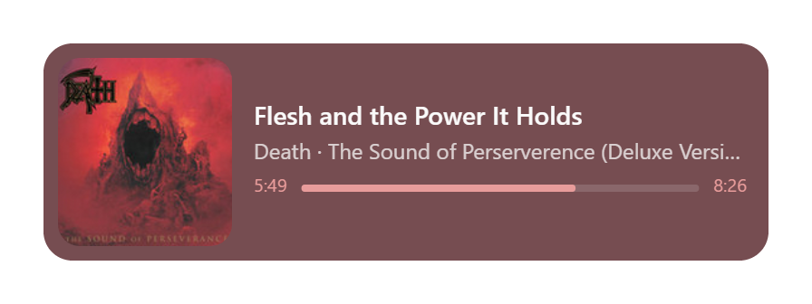
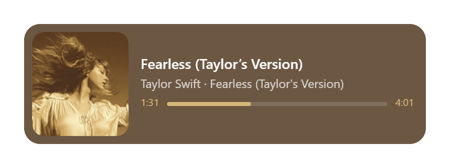

<div align="center">


# Frieda Player

**A featherweight, floating now-playing widget for Windows.**

Native SMTC integration · Rust + Tauri 2 · no Electron, no bloat

[](LICENSE)
[](https://tauri.app)
[](#roadmap)

<table>
  <tr>
    <td width="50%"></td>
    <td width="50%"></td>
  </tr>
  <tr>
    <td align="center"><em>Death — red, graded to the cover</em></td>
    <td align="center"><em>Taylor Swift — gold, graded to the cover</em></td>
  </tr>
</table>
<br>
<em>Color-graded to the album art — artwork, metadata, animated progress.</em>

</div>

---

## What is this?

Frieda Player is a small frameless card that lives on your desktop and mirrors
whatever is playing through the Windows System Media Transport Controls
(SMTC) — the same feed behind the Windows media flyout. If your player
integrates with Windows' native media keys, the widget can see and control it:
**Spotify, Tidal, Edge, Chrome, Apple Music,foobar2000** and friends.

It is a visualizer/controller, not a player: the widget reads metadata,
artwork and timeline, and sends play/pause/skip back through the OS. It never
touches audio playback itself — the only thing it touches is volume.

### Why this exists

Because music is more than sound waves on your ears. Album artwork is part of
the music — the mood the artist wanted you in before the first note played —
and this widget is an attempt to honor that: capturing the artwork's (and
thus the music's) mood into color combinations, chosen deterministically by
the algorithm or by curated selection, so that what you see matches what you
hear. Enjoying music more by making the two inputs agree is the whole point
of this program.

## Features

- **Frameless floating card** — transparent, draggable, always-on-top by default
- **Live metadata** — artwork, title, artist · album, and a smoothly animated
  progress bar
- **Color grading** — the card tints itself to the artwork. Inspired by
  Panic's iTunes 11 algorithm ([blog post](https://blog.panic.com/itunes-11-and-colors/),
  [ColorArt](https://github.com/panicinc/ColorArt)) and by [Seth Thompson's
  StackOverflow walkthrough](https://stackoverflow.com/questions/13637892/how-does-the-algorithm-to-color-the-song-list-in-itunes-11-work)
  of it: the two most common perceptually-distinct colors (compared in the
  YUV color space) become the card color and the accent (progress bar,
  timestamps), nudged until they pass [WCAG](https://www.w3.org/TR/WCAG22/)
  contrast (≥ 4.5:1) against each other. Bright covers earn bright cards with
  dark text; dark covers the reverse. Dark artwork doesn't collapse to the
  same flat black card either: if near-black isn't at least 70% of the cover,
  the most common color that *isn't* black gets blended in, so the card stays
  dark but keeps the cover's own hue. Covers the algorithm can't feel right
  about can be hand-tuned via curated **colorways** (per-album overrides,
  user-extensible). Toggle it in the tray (**Dynamic Theme**). No
  dependencies — just canvas math (`src/theme.ts`, `src/colorways.ts`)
- **Hover controls** — previous / play-pause / next with instant feedback
  (optimistic UI + pending spinner), a click-to-seek bar along the bottom
  edge, and a **copy button** that redraws the card onto your clipboard as a
  PNG — the shortcut for sharing what you're listening to (the print dialog
  is deliberately disabled; a transparent widget prints to nothing)
- **Volume, and it's the app's own** — the slider drives the media app's audio
  sessions (the same slider as its entry in the Windows volume mixer), found by
  matching the SMTC source app's AUMID to its WASAPI sessions; it falls back to
  system volume when the app exposes none. SMTC has no volume API, so this is
  Core Audio underneath — no extra permissions, still no dependencies. Arrow
  keys work while the widget is focused: ←/→ seek, ↑/↓ volume
- **Long titles don't get truncated away** — text that overflows drifts out to
  its tail and back on a slow cycle (only as far as it needs to; text that fits
  never moves), so the full name is readable at a glance
- **System tray resident** — right-click for Show/Hide, Always on Top,
  Run at Startup, Dynamic Theme, Check for Updates, and Quit
- **Sips resources** — fully event-driven (zero polling; SMTC change events
  wake the backend instantly), state is only sent to the UI when it actually
  changes, and the progress bar interpolates locally between ticks
- **Truly native read path** — Windows.Media.Control via the `windows` crate,
  no polling of window titles or media key hooks

## Install

Grab the latest installer from [Releases](https://github.com/wsalas19/frieda-player/releases):

- `Frieda.Player_0.3.1_x64-setup.exe` (NSIS, recommended)
- `Frieda.Player_0.3.1_x64_en-US.msi`

The app updates itself: the tray menu's **Check for Updates** offers new
releases, and the card asks before anything is downloaded. Windows Defender
SmartScreen may warn about an unsigned beta installer — expected until
Authenticode signing lands (see roadmap).

Or build from source (below).

## How it works

```
┌──────────────────────────── Tauri 2 ────────────────────────────┐
│                                                                  │
│  Rust backend (src-tauri/src)          React UI (src/)           │
│  ┌──────────────────────────┐          ┌──────────────────────┐  │
│  │ media.rs                 │ media-   │ App.tsx              │  │
│  │  SMTC event loop (MTA)   │ state    │  card · progress ·   │  │
│  │  artwork → base64        │ event    │  hover controls      │  │
│  │  state diffing           │ ───────▶ │  local interpolation │  │
│  │  control channel  ◀──────│──────────│  control action      │  │
│  └──────────────────────────┘ invoke   └──────────────────────┘  │
│  lib.rs: tray menu · autostart · window toggling                 │
└──────────────────────────────────────────────────────────────────┘
```

| Piece | Where |
| --- | --- |
| SMTC event loop, artwork decoding, transport controls | `src-tauri/src/media.rs` |
| Tray menu, autostart, window management | `src-tauri/src/lib.rs` |
| Widget UI (drag region, controls, progress) | `src/App.tsx` |

> 📐 Full technical documentation — architecture, IPC contract, the artwork
> state machine, and pitfalls — lives in [docs/ARCHITECTURE.md](docs/ARCHITECTURE.md).

The core IPC surface is three messages: a `media-state` event (backend →
frontend, lightweight metadata/timeline JSON), a `media-art` event (backend →
frontend, fired only when the artwork bytes change, so the base64 payload
never rides along with position ticks), and a `control` command (frontend →
backend, `play_pause | next | prev | seek:<ms> | volume:<0..1>`). A few smaller messages
handle startup state sync, the Dynamic Theme preference, and update checks —
see [docs/ARCHITECTURE.md](docs/ARCHITECTURE.md).

A few implementation notes worth knowing if you're hacking on it:

- The media thread initializes WinRT as **multithreaded (MTA)** — blocking
  `IAsyncOperation::get()` on an STA thread without a message pump deadlocks.
- The loop is **event-driven, not polling**: handlers on SMTC's
  `MediaPropertiesChanged` / `PlaybackInfoChanged` / `TimelinePropertiesChanged`
  (plus `CurrentSessionChanged` on the manager) push a refresh message into the
  same mpsc channel the UI's control actions use, so any change — including a
  click — wakes the loop instantly. A 5s `recv_timeout` fallback just re-syncs
  the position for the frontend's interpolator.
- **Artwork staleness**: some providers (Tidal notably) keep serving the
  *previous* track's artwork stream for seconds after the metadata event fires,
  and the title settles before the art does — so no fixed delay works. Instead,
  a read whose bytes are identical to the previous track's art is treated as
  stale and retried every second until the bytes differ (capped at 5 retries to
  tolerate back-to-back tracks that legitimately share artwork) — except when
  the new track is on the *same album*, in which case the lingering stream is
  by definition the correct art and is reused immediately. Reads that fail
  outright are also retried, so the already-playing track renders correctly on
  app start (the frontend also fetches the last known state on mount via
  `get_state`, covering startup with a session already active).

## Development

Prerequisites: **Node.js 18+**, **Rust** (rustup, `stable-x86_64-pc-windows-msvc`),
and **VS Build Tools** with the "Desktop development with C++" workload.

```bash
npm install        # frontend deps
npm run tauri dev  # hot-reload dev session
```

Checks (also run in CI on every push/PR):

```bash
npm run lint          # ESLint (incl. a cyclomatic-complexity budget)
npm run format:check  # Prettier
npm test              # Vitest unit tests
npm run build         # tsc + vite production build
cargo fmt --check     # Rust formatting   (in src-tauri/)
cargo clippy          # Rust lints        (in src-tauri/)
cargo test            # Rust tests        (in src-tauri/)
```

Releasing is scripted — see [docs/RELEASING.md](docs/RELEASING.md) (`npm run release -- patch`).

Release build (installs land in `src-tauri/target/release/bundle/`):

```bash
npm run tauri build
```

## Roadmap

- [x] Windows SMTC backend (metadata, artwork, controls, tray, autostart)
- [x] Packaging polish: custom app/tray icon, signed auto-update channel
- [x] CI: Windows installers + updater artifacts built on tag
      (`.github/workflows/release.yml`)
- [ ] Authenticode code signing (removes SmartScreen warnings on install)
- [ ] **Phase 2 — Linux:** swap the media backend for MPRIS behind the existing
      `#[cfg(target_os)]` seam (`src-tauri/src/media.rs`), WebKitGTK frontend,
      `.AppImage`/`.deb` artifacts, CI for Linux artifacts on tag

## Contributing

Issues and PRs are welcome — this is an early beta, so crash logs, artwork
quirks, and player-compatibility reports are especially useful. Keep the
backend seam (`media.rs`) OS-conditional — that's what keeps the Linux port
cheap.

## License

[MIT](LICENSE) © 2026 wsalas19
